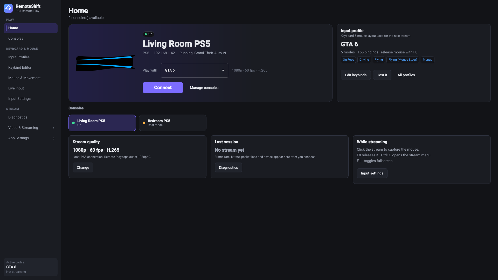
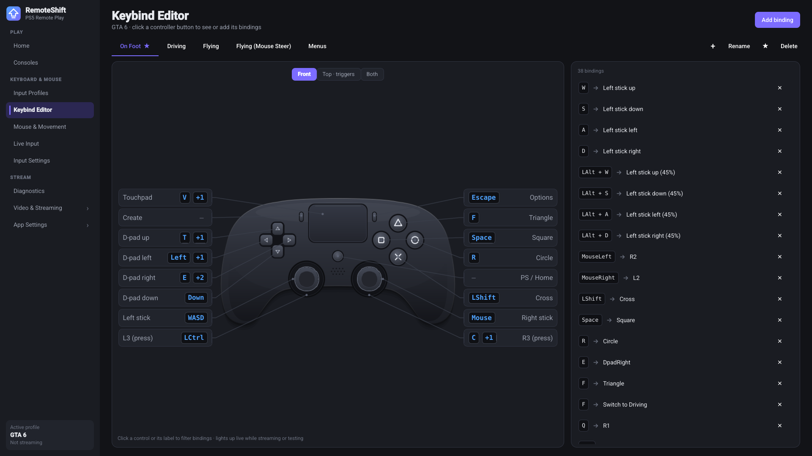
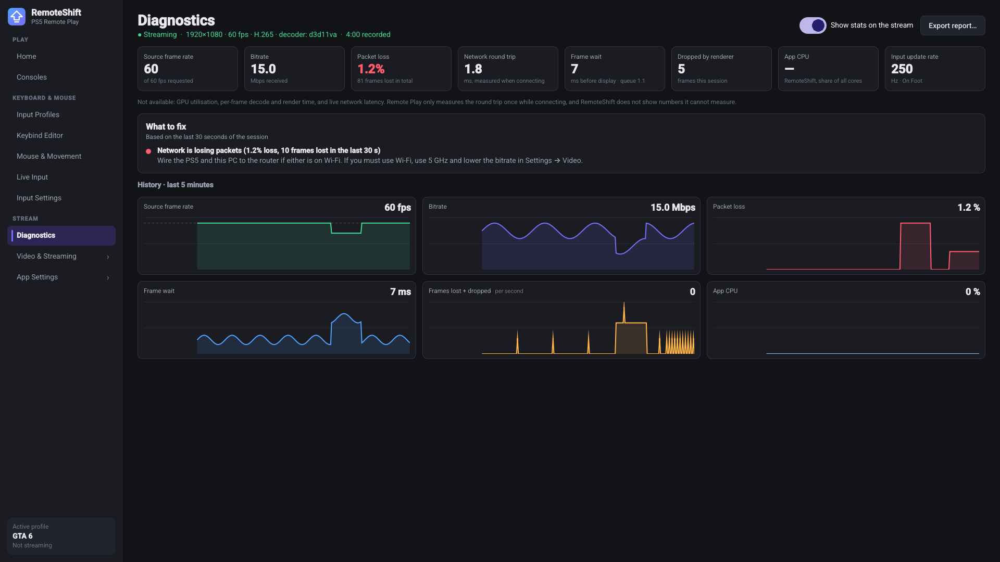
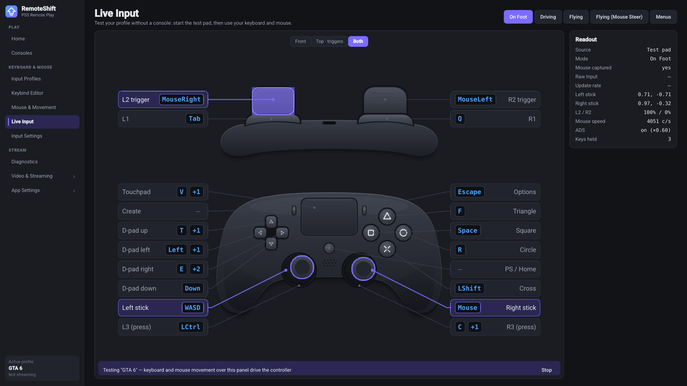
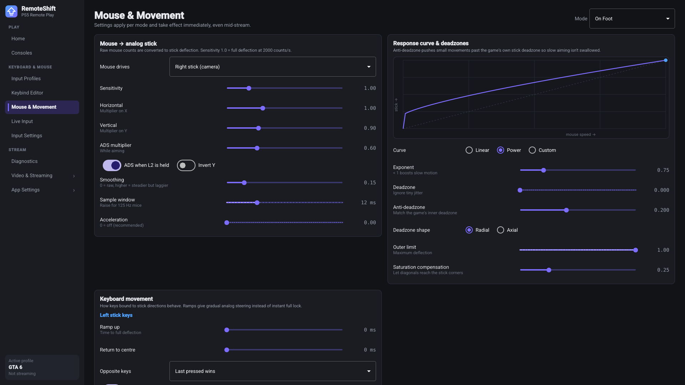

# RemoteShift

**Free, open-source PS5 Remote Play for Windows, built for keyboard & mouse.**

RemoteShift is a fork of [chiaki-ng](https://github.com/streetpea/chiaki-ng). It keeps chiaki-ng's proven
Remote Play stack (discovery, registration, wake, PSN remote play, H.264/H.265 decoding, libplacebo
rendering, DualSense haptics) and adds a keyboard & mouse engine of its own. It is meant to be the low-latency,
subscription-free alternative to paid KBM-for-Remote-Play tools.

- No subscription, no account, no ads, no telemetry. The only network request beyond Remote Play itself is an optional update check against this project's GitHub Releases.
- No virtual controller driver and no admin rights. Keyboard and mouse input is converted straight into the DualSense state that Remote Play sends to the console.
- No console modification, exploits or anti-cheat bypasses. It is an ordinary Remote Play client.



| Keybind editor | Diagnostics |
|---|---|
|  |  |
| Live input (test pad, no console needed) | Mouse response tuning |
|  |  |

---

## Quick start

1. Install `RemoteShift-x.y.z-win64-setup.exe` (per-user, no admin), or unzip the portable build anywhere.
2. Turn on Remote Play on the PS5: **Settings → System → Remote Play → Enable Remote Play**.
3. Start RemoteShift. Your PS5 appears automatically on the local network (or use **Add Manual Host**). Select it and enter the 8-digit code from **Settings → System → Remote Play → Pair Device** to register.
4. On **Home**, pick the console and an input profile (**GTA 6** is bundled), then press **Connect**. If a game is already running, the profile whose *Game* field matches it is picked for you.
5. **Click the stream to capture the mouse.** Press **F8** to release it (configurable).

While the mouse is captured, every key goes to the game. Window shortcuts like Ctrl+O and Ctrl+S are paused so that crouching with Ctrl can't trigger them. Release with F8 first, then use Ctrl+O for the stream menu.

## Keyboard & mouse engine

All of it is set per profile and per mode under **Keyboard & Mouse** in the sidebar and takes effect immediately.

| Area | What you get |
|---|---|
| Mouse → stick | Windows Raw Input (unaccelerated, full polling rate), cursor confined to the stream while captured, sensitivity plus separate X/Y, invert Y, which stick the mouse drives |
| Consistency | Velocity is measured over a time window with each mouse report spread over its own interval, so a 125 Hz mouse and an 8 kHz mouse give the same steady deflection (tested: <2% jitter at 125 Hz) |
| Response | Linear, power or custom (draggable) curves; deadzone; radial or axial anti-deadzone; outer limit; saturation compensation (circle→square so diagonals reach the corners); optional acceleration with a cap; adjustable smoothing |
| Aiming | ADS multiplier, applied automatically while L2 is held or via a dedicated hold key; per-binding sensitivity multipliers (precision/sniper key) |
| Bindings | Multiple keys per button and multiple buttons per key; modifier chords (`LAlt + W`), where the most specific chord wins; hold, toggle and turbo; mouse buttons incl. side buttons; wheel up/down/left/right as timed pulses |
| Movement | WASD with analog amounts (walk = 45%), opposite-key behaviour (last wins / neutral / first wins), circular diagonals, ramp-up/return times for gradual analog steering, trigger ramps for throttle |
| Modes | Any number of modes per profile, switched by set, hold-for or cycle bindings. A key can press a button *and* switch modes, e.g. **F** = Triangle + enter Driving |
| Controller | A connected physical controller keeps working alongside keyboard & mouse |
| Profiles | Unlimited profiles stored as readable JSON, import/export, duplicate, recently used profiles on the home screen |
| Editor | Controller diagram showing what is bound where, a binding editor with press-to-capture, and a live view of the exact state sent to the console |
| Test pad | Try a profile without a console: the Live Input page runs the same engine offline |

### Bundled GTA 6 profile

Rockstar hasn't published GTA 6's controls in a form we can verify, so the bundled profile follows **GTA V's default PS5 layout** as a starting point. Every binding can be edited.

| Mode | Highlights |
|---|---|
| **On Foot** | WASD move (LAlt = walk), mouse camera, LMB fire (R2), RMB aim (L2, ADS sensitivity), Shift sprint, Space jump, R reload, E interact, F enter vehicle, Q cover, Tab weapon wheel, Ctrl crouch, wheel = previous/next |
| **Driving** | W/S throttle/brake with ramps, A/D gradual analog steering (LAlt = fine steering), Space handbrake, E horn, mouse camera, F exit vehicle |
| **Flying** | W/S pitch, A/D roll (ramped), Q/E yaw, Shift/Ctrl throttle, G landing gear |
| **Flying (Mouse Steer)** | Mouse flies the aircraft on the left stick with its own sensitivity; A/D yaw, W/S throttle |
| **Menus** | WASD/arrows = D-pad, Enter/LMB = Cross, Backspace/RMB = Circle, mouse moves the map cursor, wheel zooms |

Mode keys: **F1** On Foot · **F2** Driving · **F3** Flying · **F4** Flying (Mouse Steer) · **F5** Menus · **`** cycles. **F** switches On Foot ↔ Driving as you enter or exit a vehicle. **Esc** pauses and switches to Menus; Esc again resumes On Foot. RemoteShift can't see what's happening in the game, so if you enter a helicopter press F3.

### Tuning tips

- Start with **Sensitivity** and leave acceleration at 0.
- If slow aiming does nothing, raise **Anti-deadzone** until the camera just starts to creep with tiny mouse movements. That value matches the game's own deadzone.
- If fast flicks feel capped, lower the **Exponent** (power curve) or raise sensitivity. The curve chart shows your live mouse speed as a dot.
- On a 125 Hz mouse, raise **Sample window** to about 16 ms if you see judder.

## Streaming

These come from chiaki-ng: PS5 1080p/720p/540p/360p at 60 or 30 fps, H.264 or H.265 (HEVC) with HDR, configurable bitrate, hardware decoding (D3D11VA, Vulkan or CUDA, with CUDA preferred automatically on NVIDIA GPUs such as the RTX 3080), libplacebo rendering with GPU upscaling presets, fullscreen/zoom/stretch, audio output and microphone device selection, DualSense haptics and rumble, a stream stats overlay (bitrate, packet loss, dropped frames, decode queue, frame age) and PSN remote connection outside your home network.

RemoteShift adds an on-stream badge showing the active profile and mode, plus a capture hint.

## Diagnostics

The **Diagnostics** page records one sample per second while you stream and keeps the last ten minutes:

- Live values: source frame rate (decoded frames per second), bitrate, packet loss, frames lost, network round trip (measured once by Remote Play while connecting), frame wait and decode queue, frames dropped by the renderer, RemoteShift's own CPU use, and the keyboard & mouse update rate.
- Five-minute history charts and plain-language advice ("Network is losing packets: wire the PS5…").
- **Export report** writes a text file with the session summary and samples. It contains no console names, addresses, account IDs or keys.
- The on-stream stats overlay (toggle on the page, or in Settings) shows the same measured values plus the input mode.

Only measured values are shown. GPU utilisation, per-frame decode/render time and live latency aren't measured, and the page says so instead of estimating them.

## Build

### Windows installer (recommended): GitHub Actions

The repository includes `.github/workflows/remoteshift-windows.yml`, which builds RemoteShift with MSYS2 (the toolchain chiaki-ng ships its Windows releases with), runs the tests, smoke-starts the app, and produces the installer and the portable zip on every push to `main`.

```powershell
gh repo create remoteshift --public --source . --push      # or push to an existing repo
# Actions → "RemoteShift Windows build" → artifacts (about 15 minutes)
git tag v0.1.0; git push --tags                              # publishes a GitHub Release
```

The update checker uses the repository the build ran in, so releases you publish are what users are notified about.

### Local build (Linux, for development)

```bash
git submodule update --init --recursive
cmake -S . -B build -G Ninja -DCMAKE_PREFIX_PATH=/path/to/Qt/6.x/gcc_64 \
      -DCHIAKI_ENABLE_CLI=OFF -DCHIAKI_ENABLE_STEAMDECK_NATIVE=OFF -DCHIAKI_ENABLE_SETSU=OFF -DCHIAKI_ENABLE_STEAM_SHORTCUT=OFF
cmake --build build
ctest --test-dir build        # rsinput_tests, rsinputcontroller_test, upstream unit tests
```

Requires Qt ≥ 6.8 and libplacebo ≥ 7.349, plus chiaki-ng's usual dependencies (FFmpeg, SDL2, OpenSSL, Opus, json-c, miniupnpc, protobuf, libevent).

### Project layout

| Path | Contents |
|---|---|
| `rsinput/` | Platform-neutral keyboard & mouse engine (C++17, no Qt), profile JSON, unit tests, bundled presets (`presets/generate.py` regenerates them) |
| `gui/src/rsinputcontroller.cpp` | Session glue: Qt events and Raw Input → engine → Remote Play controller state |
| `gui/src/rsrawmouse.cpp` | Windows Raw Input + cursor confinement |
| `gui/src/rsprofilestore.cpp` | Profiles on disk, editing API for QML, live telemetry, offline test pad, update check |
| `gui/src/rsdiagnostics.cpp` | Per-second stream samples, history, advice and the exportable report |
| `gui/src/qml/Rs*.qml` | App shell (`RsShell`), Home, Consoles, Diagnostics and the keyboard & mouse pages |
| `gui/tests/` | Qt integration tests for the input controller |
| `gui/tools/rsuiharness.cpp` | Developer tool: renders the QML pages offscreen to PNG (`-DREMOTESHIFT_BUILD_UI_HARNESS=ON`) |

## Data & portable mode

- Installed: settings and registrations live in the current user's registry (`HKCU\Software\RemoteShift\RemoteShift`), and input profiles in `%APPDATA%\RemoteShift\RemoteShift\profiles\*.json`.
- Portable: a `portable.txt` next to `RemoteShift.exe` keeps everything in a `data` folder beside it. The portable zip ships with this file.
- RemoteShift uses its own storage, so it doesn't share or touch an existing chiaki-ng installation. Register your console once in RemoteShift.

## Status and limitations

Read this section before relying on a feature.

**Implemented in this fork and tested:** the app shell (Home, Consoles, the five keyboard & mouse pages, Diagnostics), the full keyboard & mouse engine, Raw Input, capture and release, profiles with automatic selection by running game, the GTA 6 profile, diagnostics history/advice/report, the extended stats overlay, the rebrand, portable mode, the GitHub Releases update check, and the Windows CI that builds the installer and portable zip and runs the tests on Windows.

**Inherited from chiaki-ng:** everything in *Streaming*, plus discovery, registration, wake from rest, manual IP, multiple consoles, PSN remote play, microphone, haptics, and session logs with optional sanitising. *Video & Streaming* and *App Settings* in the sidebar open chiaki-ng's settings screens, re-themed but not redesigned.

**Not implemented yet:**

- Discord Rich Presence, screenshots and local recording, the system tray, and system-wide (global) hotkeys.
- A game library page. Remote Play can't list or launch games; it only reports the title currently running.
- Per-game streaming settings.
- Encrypting stored registration keys with Windows DPAPI. Like chiaki-ng, they are stored per-user and unencrypted.

**Protocol limits (not fixable client-side):**

- Remote Play streams at most **1080p60**. Output can be upscaled on your GPU, but it is never more than 1080p of source detail.
- Bitrate is negotiated when the session starts, so there is no mid-session adaptive bitrate.
- Frame interpolation is limited to libplacebo's frame mixing, which smooths frame pacing but creates no new frames. Generated frames would add latency and aren't presented as native.
- Remote Play adds network and encode latency that no client can remove. Keyboard & mouse input is sent within one engine tick (key presses immediately, mouse at 250 Hz by default, up to 1000 Hz).

## License

AGPL-3.0 with the OpenSSL exception, same as chiaki-ng (see `LICENSES/` and `COPYING`). See `NOTICE.md` for attributions.
RemoteShift isn't affiliated with Sony Interactive Entertainment, Rockstar Games, or OmniControl.
"PlayStation", "PS5" and "DualSense" are trademarks of Sony Interactive Entertainment.
